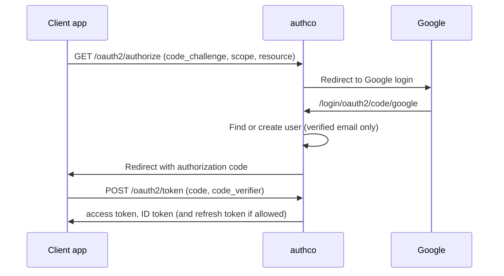

# authco

authco is an OAuth 2.1 / OpenID Connect (OIDC) authorization server built on
[Spring Authorization Server](https://spring.io/projects/spring-authorization-server).
Users log in with their Google account (federated login). authco then issues its own
signed JWTs (JSON Web Tokens) to client applications: the finco apps and MCP (Model
Context Protocol) clients such as Claude. Resource servers validate those tokens
against the authco signing keys.

- Stack: Java 25, Spring Boot 4, PostgreSQL, Flyway.
- Every endpoint lives under the context path `/authco` on port `8087`.

## Quick start

### With Docker Compose

1. Create a `.env` file at the repository root (it is git-ignored):

   | Variable | What it is |
   |----------|------------|
   | `USER_DB` | PostgreSQL user (compose creates it) |
   | `PASSWORD_DB` | PostgreSQL password |
   | `MASTER_KEY` | AES-256 key that encrypts the signing keys at rest. Must be Base64 and decode to exactly 32 bytes |
   | `GOOGLE_CLIENT_ID` | OAuth client ID from Google Cloud Console |
   | `GOOGLE_CLIENT_SECRET` | OAuth client secret from Google Cloud Console |

   Generate the master key with:

   ```bash
   openssl rand -base64 32
   ```

   In the Google OAuth client, add this authorized redirect URI:
   `http://localhost:8087/authco/login/oauth2/code/google`.

2. Build and start Postgres and authco:

   ```bash
   docker compose up -d --build
   ```

3. Check that it is ready (the first start can take up to a minute):

   ```bash
   curl http://127.0.0.1:8087/authco/actuator/health/readiness
   # {"status":"UP"}
   ```

4. Read the admin password. It is printed **once**, on the very first start:

   ```bash
   docker compose logs authco | rg -A4 'admin API credentials'
   ```

   Store it. It cannot be recovered. To reset it, delete the row in
   `admin_credentials` and restart.

Useful URLs after start:

| What | URL |
|------|-----|
| OIDC discovery | `http://localhost:8087/authco/.well-known/openid-configuration` |
| OAuth discovery (RFC 8414, used by MCP clients) | `http://localhost:8087/authco/.well-known/oauth-authorization-server` |
| Login page | `http://localhost:8087/authco/login` |
| Swagger UI (admin API) | `http://localhost:8087/authco/swagger-ui.html` |

The compose file also seeds a public client `finco-site` for a local SPA on
`http://localhost:4200` (see [Clients](#clients)). Set `AUTHCO_SPA_CLIENT_ID=` (empty)
in `.env` to skip it.

### Without Docker

You need Java 25 and a PostgreSQL database named `authco` on `localhost:5432`.
Export the same variables as above, then run:

```bash
./gradlew bootRun
```

Flyway creates the schema on startup. Use `DB_URL` to point at another database.

## How it works

### Login flow

authco never stores passwords. The only identity provider is Google.

- On the first login, authco creates a user with an internal UUID. That UUID is the
  `sub` (subject) of every token, not the Google ID.
- If a user with the same email already exists, the Google identity is linked to it.
- Logins with an **unverified** Google email are refused (`unverified_email`).
- Clients that require consent show a consent page with the requested scopes.

Authorization code flow with PKCE (Proof Key for Code Exchange), the only flow authco
supports for users:



### Clients

A client exists in one of three ways:

| Way | How | Notes |
|-----|-----|-------|
| Admin API | `POST /authco/admin/clients` | `PUBLIC` (PKCE only) or `CONFIDENTIAL` (gets a generated secret, shown once). Redirect URIs must be `https`; `http` is accepted only for `localhost`, `127.0.0.1`, `[::1]` and `*.localhost`. You choose whether consent is required |
| Seeded SPA | `AUTHCO_SPA_CLIENT_*` variables | Created on startup only if missing; after that the admin API owns it. Public, PKCE, no consent, no refresh tokens. Safe when several replicas start at once |
| Dynamic Client Registration (DCR) | Anonymous `POST` to `/authco/connect/register` (OIDC) or `/authco/oauth2/register` (RFC 7591) | Used by MCP clients such as Claude. See the rules below |

Rules for anonymous DCR (nobody authenticates these requests):

- Every `redirect_uri` and `post_logout_redirect_uri` must be on the allowlist
  `AUTHCO_DCR_ALLOWED_REDIRECT_URIS`. Entries are exact URIs, except loopback entries
  with a wildcard port (`http://127.0.0.1:*`, `http://localhost:*`), which accept any
  port (RFC 8252).
- At least one redirect URI is required.
- Only the `authorization_code` and `refresh_token` grants are allowed. Other grants
  are rejected.
- PKCE is always required. Requested scopes are narrowed to `openid`, `profile` and
  `email`.
- `token_endpoint_auth_method=none` creates a public client without a secret.
- Rate limit per client IP (default 30 per 10 minutes). Over the limit the answer is
  `429` with `Retry-After`.

A demo client `oidc-client` (well-known secret, redirect `http://127.0.0.1:8888/callback`)
is created only when `AUTHCO_SEED_DEMO_CLIENT=true`. Never enable it in production.

### Tokens

| Item | Value |
|------|-------|
| Access token lifetime | 15 minutes |
| Refresh token lifetime | 1 day |
| Signing algorithm | RS256 |
| `sub` | Internal authco user UUID |

**Scopes in the access token** = (scopes the client was granted ∩ `openid`, `profile`,
`email`) ∪ the user's roles from the database. Roles are namespaced scope strings,
for example `finco:premium`, `finco:admin`, `platform:premium`. A client can never ask
for a role scope; only the user's roles grant them.

**ID token claims:** `email` and `email_verified` with the `email` scope, `name` with the
`profile` scope.

**Banned users:** authco refuses to issue any new token to a banned user, refreshes
included. Access tokens already issued stay valid until they expire.

**Audience (RFC 8707 resource indicators):** `aud` always contains the `client_id`.
A client can also send `resource`:

- If `resource` equals, or is a path below, an entry of `AUTHCO_RESOURCES`, that entry
  goes into `aud`. An MCP client may send the URL of the MCP endpoint itself.
- Without `resource`, the first entry of `AUTHCO_RESOURCES` (if any) goes into `aud`.
- An unknown `resource` fails with `invalid_target` at `/oauth2/authorize`, before
  consent.
- A token request can narrow the resources of the authorization, never widen them.

### Issuers

`AUTHCO_ISSUER` is the exact `iss` of every token and the base of the discovery
documents.

| Setting | Behavior |
|---------|----------|
| One issuer (usual case) | Pinned. `iss` and the discovery URLs never depend on the `Host` header |
| Several, comma-separated | One authco shared by apps on different origins. Each request gets the issuer of the origin it came through. Any other origin (for example an in-cluster call to `http://authco:8087`) is served as the **first** issuer |

With several issuers, tokens keep the issuer of the origin where `/oauth2/authorize`
started, even when the code exchange or the refresh is a back-channel call through
another origin.

Issuers are normalized before they are compared: lowercase scheme and host, no default
port (`:443`, `:80`), no trailing slash.

### Admin API

Internal administration under `/authco/admin`. It uses HTTP Basic with the `admin`
user and the password printed on first start. It is stateless (no session, no CSRF).

| Area | Endpoints |
|------|-----------|
| Users | `GET /admin/users[?email=]`, `GET/PATCH /admin/users/{id}`, `PUT /admin/users/{id}/roles`, `POST/DELETE /admin/users/{id}/ban` |
| Clients | `GET/POST /admin/clients`, `GET/PUT/DELETE /admin/clients/{clientId}` |
| Signing keys | `GET /admin/jwks`, `POST /admin/jwks/rotate`, `POST /admin/jwks/{kid}/revoke` |

Notes:

- Role changes apply to the next access token, not to tokens already issued.
- Deleting a client also deletes its authorizations and consents, so its refresh
  tokens stop working at once.
- Swagger UI: `/authco/swagger-ui.html` (same Basic credentials).

### Signing keys

- RSA 2048 keys, stored in PostgreSQL. The private key is encrypted with AES-256-GCM
  using `MASTER_KEY`.
- The first key is generated automatically when none exists.
- **Rotate** creates a new active key. The old key is retired but stays in the JWKS,
  so tokens it signed keep validating until they expire.
- **Revoke** removes a retired key from the JWKS. Every token it signed stops
  validating at once. The active key cannot be revoked: rotate first.
- If `MASTER_KEY` changes, the stored keys cannot be decrypted. Keep it safe and stable.

## Configuration reference

Spring property names are in brackets. Environment variables override the defaults.

| Variable | Default | What it does |
|----------|---------|--------------|
| `DB_URL` | `jdbc:postgresql://localhost:5432/authco` | JDBC URL of the database |
| `USER_DB` | none (required) | Database user |
| `PASSWORD_DB` | none (required) | Database password |
| `MASTER_KEY` [`authco.jwk.master-key`] | none (required) | Base64 AES-256 key (32 bytes) for the signing keys. A legacy `master-key` entry is also read |
| `GOOGLE_CLIENT_ID` | none (required) | Google OAuth client ID |
| `GOOGLE_CLIENT_SECRET` | none (required) | Google OAuth client secret |
| `AUTHCO_ISSUER` [`authco.issuer`] | `http://localhost:8087/authco` | Public issuer. Comma-separated for several origins |
| `AUTHCO_TRUSTED_PROXIES` [`server.tomcat.remoteip.internal-proxies`] | `127.0.0.0/8, ::1/128` | Proxies whose `X-Forwarded-*` headers are trusted (comma-separated CIDRs, or a regex) |
| `CORS_ALLOWED_ORIGINS` [`authco.cors.allowed-origins`] | `http://localhost:4200` | Browser origins allowed by CORS (comma-separated). Methods `GET`, `POST`, `OPTIONS`; no credentials |
| `AUTHCO_DCR_ALLOWED_REDIRECT_URIS` [`authco.dcr.allowed-redirect-uris`] | `https://claude.ai/api/mcp/auth_callback,https://claude.com/api/mcp/auth_callback,http://127.0.0.1:*,http://localhost:*` | Redirect URIs anonymous DCR accepts |
| `AUTHCO_DCR_RATE_LIMIT_MAX_REQUESTS` [`authco.dcr.rate-limit.max-requests`] | `30` | Registrations allowed per client IP and window |
| `AUTHCO_DCR_RATE_LIMIT_WINDOW` [`authco.dcr.rate-limit.window`] | `10m` | Length of the rate limit window |
| `AUTHCO_RESOURCES` [`authco.resources`] | empty | Canonical URIs of the resource servers (RFC 8707), comma-separated. The first one is the default audience |
| `AUTHCO_SEED_DEMO_CLIENT` [`authco.seed-demo-client`] | `false` | Seeds the demo client `oidc-client`. Never in production |
| `AUTHCO_SPA_CLIENT_ID` [`authco.spa-client.client-id`] | empty (disabled) | `client_id` of the seeded first-party SPA |
| `AUTHCO_SPA_CLIENT_REDIRECT_URIS` | empty | Redirect URIs of the seeded SPA |
| `AUTHCO_SPA_CLIENT_POST_LOGOUT_REDIRECT_URIS` | empty | Post-logout redirect URIs of the seeded SPA |
| `SERVER_SERVLET_SESSION_TIMEOUT` | `30m` (Spring Boot default) | Lifetime of the login session cookie |

Docker Compose overrides some defaults: `DB_URL` points at the `postgres` service,
`AUTHCO_RESOURCES` defaults to `http://localhost:8086/finco-api/v1`, and the SPA client
defaults to `finco-site` with redirect `http://localhost:4200/auth/callback`.

## Endpoints

All paths include the `/authco` context path.

| Path | Purpose | Auth |
|------|---------|------|
| `/.well-known/openid-configuration` | OIDC discovery | None |
| `/.well-known/oauth-authorization-server` | OAuth discovery (RFC 8414) | None |
| `/oauth2/authorize` | Start the authorization code flow | User login (redirects to `/login`) |
| `/oauth2/token` | Exchange code, refresh token | Client (secret or PKCE) |
| `/oauth2/jwks` | Public signing keys (JWKS) | None |
| `/oauth2/introspect`, `/oauth2/revoke` | Token introspection and revocation | Client |
| `/userinfo` | OIDC user info | Access token |
| `/connect/logout` | OIDC logout | ID token hint |
| `/connect/register`, `/oauth2/register` | Anonymous Dynamic Client Registration | None (rate limited) |
| `/login` | Login page (Google button) | None |
| `/login/oauth2/code/google` | Google callback | None |
| `/oauth2/consent` | Consent page | User login |
| `/actuator/health`, `/actuator/health/liveness`, `/actuator/health/readiness` | Health probes (status only) | None |
| `/admin/**` | Admin API | HTTP Basic (admin) |
| `/swagger-ui.html`, `/v3/api-docs/**` | Admin API docs | HTTP Basic (admin) |

No authco page can be framed (`X-Frame-Options: DENY`).

## Deploying behind a proxy or on Kubernetes

| Topic | What to do |
|-------|------------|
| Trusted proxies | Set `AUTHCO_TRUSTED_PROXIES` to the CIDR of your reverse proxy or ingress controller. Only then are `X-Forwarded-For/Proto/Host/Port` honored. Never use a range that direct clients can come from |
| Client IP | The DCR rate limit uses the client IP after this step. Without trusted proxies, every client looks like the proxy |
| Issuer | Set `AUTHCO_ISSUER` to the public URL, e.g. `https://auth.example.com/authco` |
| Several origins | List every public origin in `AUTHCO_ISSUER`, comma-separated, and add each SPA origin to `CORS_ALLOWED_ORIGINS` |
| Probes | Liveness: `/authco/actuator/health/liveness`. Readiness: `/authco/actuator/health/readiness` (includes the database check). Port `8087` |
| Port binding | Compose publishes authco only on `127.0.0.1:8087`, so nobody on the network can bypass the proxy |

### Migration notes

Migration `V8__uniqueClientId.sql` adds a unique constraint on
`oauth2_registered_client.client_id`. It **fails** if duplicates already exist. Check
before you upgrade:

```sql
SELECT client_id, COUNT(*)
FROM oauth2_registered_client
GROUP BY client_id
HAVING COUNT(*) > 1;
```

Delete or rename the duplicates, then start the new version.

## Development

### Project layout

Code is in `src/main/java/authco`:

| Package | Responsibility |
|---------|----------------|
| `admin` | Admin REST API, its Basic auth, admin credentials, Swagger config |
| `client` | Client creation and validation, seeded SPA client |
| `config` | Authorization server security chains, CORS, issuers |
| `jwk` | Signing key generation, rotation, revocation and encryption |
| `security` | DCR policy and rate limit, token customization, resource indicators, Google login mapping |
| `user` | Users, roles, federated identities, bans |
| `web` | Login and consent pages (Thymeleaf templates in `src/main/resources/templates`) |

### Tests

```bash
./gradlew test
```

Integration tests start PostgreSQL with Testcontainers, so Docker must be running.
Test settings are in `src/test/resources/application-test.yml`.

### Database migrations

Flyway migrations are in `src/main/resources/db/migration` (`V1__...` to `V8__...`).
Add a new `V<n>__description.sql` file; never edit a migration that already ran.

## Known limitations

- **DCR rate limit is per replica.** It is kept in memory, so with N replicas a
  client can register up to N times the limit.
- **`ClientAdminService.list()` has an N+1 query.** It loads every client with a
  separate query. Fine for a few clients, slow for many.
- **Compose publishes Postgres on all interfaces** (`5432:5432`). Restrict it to
  `127.0.0.1` on shared machines.
- **No silent authentication.** The `prompt=none` iframe renewal was removed, and
  authco cannot be framed. SPAs must renew tokens with refresh tokens or a full-page
  redirect to `/oauth2/authorize`. The seeded SPA is a public client and gets no
  refresh tokens, so it uses the redirect.
